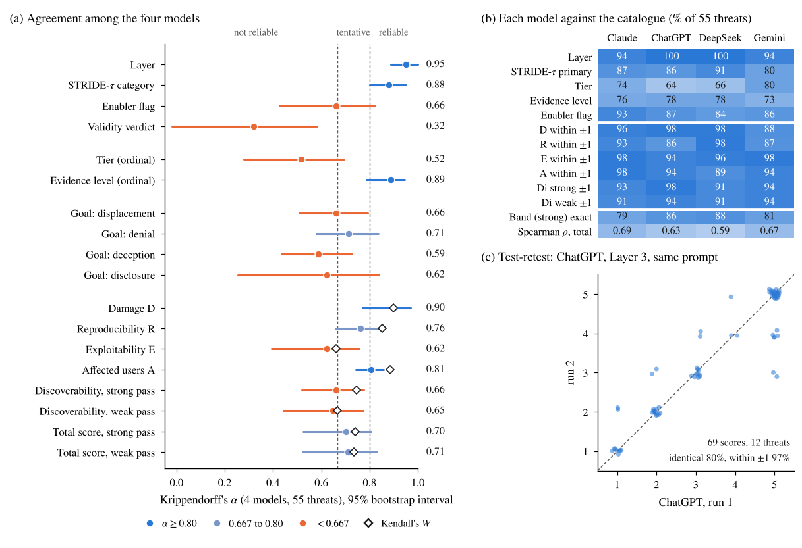

# LEO-MLAT Threat Atlas: SATERA threat catalogue, evidence atlas, LLM review panel and analysis code

Research data and code behind the paper **"Cross-Layer Threat Modelling of GNSS-Independent Space-Based
Multilateration for Air Traffic Surveillance"** by Bilal Ahmad Kamal, Naghmeh Ivaki and Henrique Madeira
(CISUC, University of Coimbra; manuscript in preparation for IEEE Transactions on Dependable and Secure Computing).

The paper builds a layered, propagation-aware threat model of space-based multilateration from low Earth orbit
(LEO MLAT-B, as specified in the SATERA reference design) and ranks 55 threats with a propagation-aware DREAD
score. This repository lets you **inspect, filter, re-score and reproduce** everything the paper reports about the
catalogue, the evidence base and the independent review of the catalogue by four language models.

> The analysis concerns the published SATERA reference design, not a fielded system. All content is at the level of
> mechanisms and ratings: no attack parameters, procedures or tooling. See [docs/RESPONSIBLE_USE.md](docs/RESPONSIBLE_USE.md).

## At a glance

| | |
|---|---|
| Layers, assets, trust boundaries | 4 layers, 27 assets, 3 inter-layer boundaries, 5 timing assets that cut across all layers |
| Threat catalogue | 55 threats (T1.01 to T4.15; 16, 12, 12 and 15 per layer), each bound to an asset, an adversary class, graded evidence and a PA-DREAD score. It refines the earlier 17-entry SATERA catalogue (see [below](#how-the-catalogue-relates-to-the-17-entry-satera-catalogue)) |
| Evidence atlas | 78 published sources, 57 CVE records, 25 mitigations; 53 of the 78 sources cross a layer |
| Validation | Stage 1: a blind panel of 4 language models from 4 vendors rates all 55 threats (220 ratings, all valid JSON, no repairs) and lists threats unprompted. Stage 2: evaluation by the co-authors. Scores and algorithms verified by 388 recomputed checks |
| Checks that run here | 388 recomputed statistics and scores (`make check`), full re-run of the panel analysis (`make panel`), regeneration of the 4 panel figures (`make figures`) |



*Agreement among the four models (a), each model against the catalogue (b) and a test-retest (c). More in
[docs/RESULTS.md](docs/RESULTS.md).*

## How the catalogue was validated

1. **Independent review by a multi-vendor LLM panel.** Four language models from four vendors rated every threat of the
   catalogue without seeing the catalogue's own ratings, and separately listed the threats they would expect from the
   architecture alone. The prompts, the replies, the agreement statistics and the figures are in `llm_panel/`
   (paper Sec. 4.11).
2. **Evaluation by the co-authors.** The panel's agreements and disagreements with the catalogue were then evaluated by the
   co-authors, and the catalogue was finalised.
3. **Verification of scores and algorithms.** Every count the paper reports and every PA-DREAD score is recomputed from the
   workbook by `make check` (388 checks), and the panel statistics are recomputed from the stored replies by `make panel`.

## How the catalogue relates to the 17-entry SATERA catalogue

The SATERA project's earlier threat catalogue lists 17 asset-level entries (SC-1 to SC-17). The **extended catalogue** of this
repository refines them into 55 threats under the paper's method (STRIDE-tau enumeration, PASTA process, effect-transfer
graphs, PA-DREAD ranking): 44 of the 55 threats refine at least one of the 17 entries and 11 are new. The 17 entries are kept,
corrected and cross-linked in the workbook sheet *SATERA*; the sheet *Review* lists the defects corrected on the way.
The 17-entry catalogue is background only; all results of this repository concern the 55-threat catalogue.

## Repository map

```
.
├── README.md                     this file
├── CITATION.cff                  how to cite
├── LICENSE, LICENSE-DATA.md      code: MIT; data, prompts, responses and documentation: CC BY 4.0
├── Makefile, requirements.txt    one-command checks and reproduction
├── CONTRIBUTING.md, CHANGELOG.md how to help; what changed
├── .github/workflows/ci.yml      runs the checks and tests on every push
├── data/
│   ├── catalogue/                SATERA Extended Threat Catalogue (xlsx, master) + csv/ snapshot
│   ├── atlas/                    PRISM-LEO Threat and Exploit Atlas (xlsx, master) + csv/ snapshot
│   ├── derived/                  values computed from the workbooks (asset reach)
│   └── README.md                 sheets, versions, validation status, notes
├── llm_panel/                    the multi-vendor language-model review (see llm_panel/README.md)
│   ├── prompts/                  the exact prompts sent to every model (A, B1 to B4) + SHA256SUMS.txt
│   ├── responses/ responses_raw/ replies as strict JSON and as copied from the chat apps
│   ├── run_log.csv, COMMANDS_LOG.txt   model version, mode, date and hash for every run
│   ├── results/                  merged ratings, agreement statistics, disagreement lists, workbook
│   ├── retest/                   a second run of one prompt (test-retest)
│   ├── sensitivity/              earlier runs kept apart: ChatGPT small parts, Gemini Flash-Lite
│   ├── completeness/             mapping of the 143 threats the models listed to the catalogue
│   ├── figures/                  scripts and output of the four panel figures
│   └── tools/                    prompt builder, validator/merger, agreement statistics, test-retest
├── scripts/                      checks against the paper, CSV export, results tables, asset reach
├── figures/                      figures of the paper that are not produced by the panel scripts (README inside)
├── docs/                         method, data dictionary, panel protocol, results, provenance, limitations
└── tests/                        pytest suite that runs the checks and the reproduction
```

## Quick start

Python 3.9 or later.

```bash
git clone https://github.com/BAKROOT/leo-mlat-threat-atlas.git
cd leo-mlat-threat-atlas
python -m venv .venv && source .venv/bin/activate        # optional
pip install -r requirements.txt

make check      # recompute the paper's counts and every PA-DREAD score from the workbooks (about 5 s)
make panel      # re-run the panel analysis from the stored responses into a scratch folder and compare with llm_panel/results/
make figures    # redraw the four panel figures into llm_panel/figures/out/
make test       # all of the above under pytest
```

Without `make`, run the commands listed in the [Makefile](Makefile) directly.

## From the paper to the files

| Statement in the paper | Where to look | How to reproduce |
|---|---|---|
| 55 threats; 16, 12, 12, 15 per layer; STRIDE-tau counts; 16 postulated; 47 High or Critical (Sec. 4.6) | `data/catalogue/` sheet *Catalogue* | `make check` (group A) |
| PA-DREAD scores and bands derived from the rubric (Sec. 4.8) | `data/catalogue/` sheets *Rubric*, *Catalogue* | `make check` (group B recomputes R, E, D, S and the band for every threat) |
| 78 sources, 57 CVEs, 25 mitigations, 53 of 78 sources cross a layer (Secs. 4.4, 6) | `data/atlas/` | `make check` (group A) |
| Cross-layer reach of the assets (Sec. 6) | `data/catalogue/` sheet *Assets*, `data/derived/asset_reach.csv` | `python scripts/asset_reach.py` |
| LLM panel: design, agreement, disagreement, completeness (Sec. 4.11, Figs. 8 to 11, Table 8) | `llm_panel/`, [docs/RESULTS.md](docs/RESULTS.md) | `make panel`, `make figures` |

## What is not here (yet)

Stated plainly so that nobody has to guess; details in [docs/LIMITATIONS.md](docs/LIMITATIONS.md).

* The edge list of the 41-edge asset dependency graph, and with it the radius and rank-correlation statistics of
  Section 6, are not part of this release. `scripts/asset_reach.py` works from the reach lists stored in the catalogue workbook.
* The completeness mapping of the language-model listings is single-coded and has not been checked by a second coder.
* The panel's raters are language models and the human evaluation was done by the co-authors; an independent study with
  external human raters has not been run.

## Using and extending the work

* **Re-score or filter the catalogue.** Open the workbook, or load `data/catalogue/csv/catalogue_55_threats.csv`.
  Evidence, R, E, D, S and the bands are formulas over the *Rubric* and *Binding* sheets in the workbook.
* **Add a source to the atlas.** Append a row to *Threat Atlas* under a new number (existing numbers #1 to #78 are stable).
* **Repeat the review with another model.** [llm_panel/README.md](llm_panel/README.md) and
  [docs/PANEL_PROTOCOL.md](docs/PANEL_PROTOCOL.md) describe the protocol; your replies drop into `llm_panel/responses/`.
* **Challenge a result.** Every response file, the raw text of every reply and the hash of every prompt are included.

## Citation

See [CITATION.cff](CITATION.cff). Until the paper is published, please cite the repository together with the
manuscript title above. A DOI will be recorded here at publication.

## Licence

Code (`*.py`, `Makefile`, tests): MIT, see [LICENSE](LICENSE). Data, prompts, model responses, figures and documentation:
CC BY 4.0, see [LICENSE-DATA.md](LICENSE-DATA.md). Titles, links and identifiers of third-party publications, CVE records
and framework techniques in the atlas remain the property of their owners.

## Acknowledgements and contact

This work was supported by the SATERA project (ITL137-25-347), funded by the European Union. The authors thank the SATERA project
partners for discussions on the operational architecture of space-based multilateration.
Contact: Bilal Ahmad Kamal (bilal@dei.uc.pt), University of Coimbra, CISUC.
