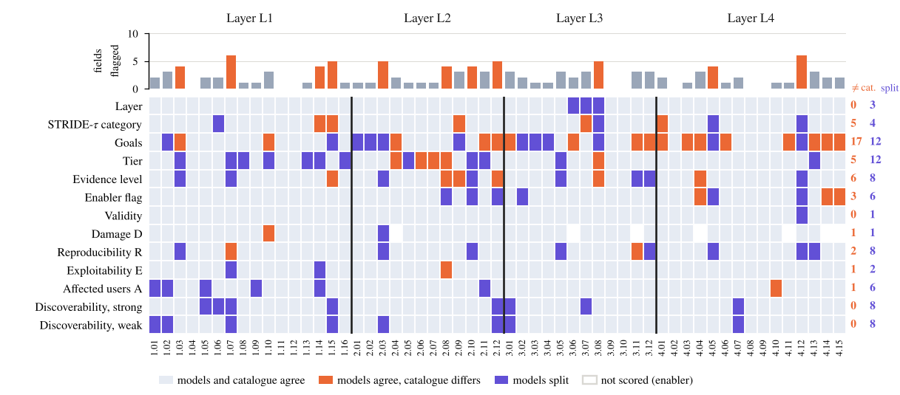
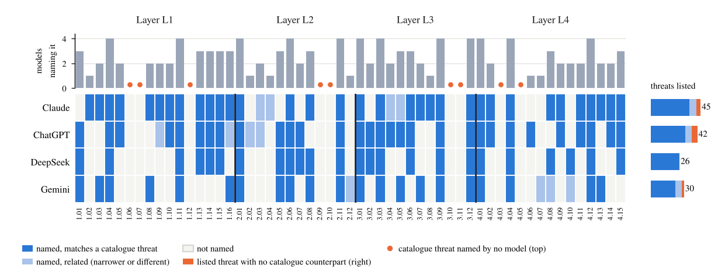

# Results of the language-model panel

Narrative summary of paper Section 4.11. Every number is generated from `llm_panel/results/`; full tables are in [RESULTS_TABLES.md](RESULTS_TABLES.md).

## 1. Design

Four models from four vendors rated the 55 threats blind (Prompts B1 to B4) and listed the threats they expect before seeing any (Prompt A). 220 ratings, all valid JSON, no repairs.

## 2. Agreement among the models

* **Reliable (alpha at least 0.800):** layer 0.95, STRIDE-tau category 0.88, evidence level 0.89 (ordinal), Damage 0.90, Affected users 0.81.
* **Tentative (0.667 to 0.800):** Reproducibility 0.76, total score 0.70 (strong pass) and 0.71 (weak pass).
* **Below the tentative limit:** Exploitability 0.62, Discoverability 0.66 (strong) and 0.65 (weak), adversary tier 0.52 ordinal (0.30 nominal), goal sets 0.59 to 0.71, enabler flag 0.66.
  In the rubric Exploitability is read from the adversary tier, so Exploitability and tier are **one weak point, not two**: the models do not agree on how capable the adversary of a record is.
* **W above alpha** for Reproducibility (0.85 against 0.76), Affected users (0.89 against 0.81) and Discoverability (0.75 against 0.66, strong pass): the models rank the threats alike and differ in how high they score.
  The mean Reproducibility is 2.09 to 2.42 across the models and 2.56 in the catalogue.
* **Validity verdict** alpha 0.32 is a prevalence effect: 212 of 220 verdicts are `valid`.

## 3. Agreement with the catalogue (panel b of the figure)

Layer matches in 94 to 100% of the threats, the primary STRIDE-tau category in 80 to 91%, the evidence level in 73 to 78% and the tier in 64 to 80%. A score is within one point of the catalogue in 86 to 98% of the ratings,
the strong-pass band matches in 79 to 88%, and the rank correlation of the total score is 0.59 to 0.69. The catalogue scores slightly higher than the panel (mean total 17.3 against 16.1 to 16.4), chiefly through Affected users and Reproducibility.

## 4. Does any single model or vendor drive the result?

Models tend to favour output of their own family (Panickssery et al., NeurIPS 2024), and the panel has one model per vendor. Three checks:

1. Agreement among the three other models differs from that among the four by at most 0.06 for every score (Damage 0.85 against 0.90, total score 0.70 against 0.70).
2. Leaving out any one model leaves alpha for the total score between 0.64 and 0.77 in the two passes.
3. Claude is not systematically closer to the catalogue: it is closest on 4 of the 13 measures of panel (b) (ties included) and furthest on one.

## 5. Repeatability

ChatGPT, prompt B3 (Layer 3, 12 threats), repeated in a new chat: of 69 scores, 80% were identical and 97% within one point; alpha between the two runs was 0.97 (D), 0.84 (R), 0.74 (E), 0.93 (A) and 0.68 and 0.64 (Di).
A single model agrees with itself on Discoverability about as well as the four models agree with each other (0.66 and 0.65), so most of that disagreement is run-to-run noise, not a difference between vendors. One layer, one model.

## 6. Where the panel and the catalogue disagree

Of 708 scored fields, 588 (83%) agree, 41 (6%) show the models agreeing with each other but not with the catalogue, and 79 (11%) are split. No threat has more than six of its 13 fields flagged.

* 17 of the 41 concern the **goal sets**: in 8, the models treat the record as an enabler with no goal of its own where the catalogue assigns goals (T2.04, T2.12, T3.06, T3.11, T4.04, T4.11, T4.14, T4.15); in 9, they name a different set, most often one goal more.
* 5 STRIDE-tau categories (T1.14, T1.15, T2.09, T3.07, T4.01), 5 tiers (T2.04, T2.06, T2.07 as T2 where the catalogue has T3; T2.08 and T3.08 one tier lower), 6 evidence levels (5 lower than the catalogue), 3 enabler flags (T4.04, T4.14, T4.15) and 5 single scores.
* Splits fall on tier and goals (12 each) and on evidence level, Reproducibility and Discoverability (8 each).
* **Contested threats** (rule in `llm_panel/tools/agreement.py`): T1.01, T1.02, T1.03, T1.04, T1.15, T2.03 and T2.10. The largest spread is 5 points of the 5 to 25 scale (T1.15, T2.03).

### Records the panel questions

| Records | What the panel says | Models |
|---|---|---|
| T4.12 | umbrella over the insider adversary class that restates other records; not a distinct threat | 4 of 4 |
| T2.02, T2.09 | same effect and mechanism, separated only by the wording of the vector | 4 of 4 |
| T2.03 | mechanism conflates delay, reordering and modification; cited work does not show selective delay | 3 of 4 |
| T3.07, T3.08 | layer, mechanism or evidence questioned; read as signal-level spoofing | 4 of 4 |
| T2.04, T2.06, T2.07 | adversary tier T2, not T3 | at least 3 of 4 |
| T4.04, T4.14, T4.15 | read as enablers without a goal of their own | at least 3 of 4 |
| candidate additions | integrity-monitor false acceptance, false rejection and alert flooding; common-mode faults across the two checks; natural clock faults that mimic an attack; ATM misreading of integrity annotations; operator social engineering; spoofing of the orbit-determination feed; satellite geometry | 1 to 3 of 4 |

These are cases for adjudication in a later release. The catalogue was not changed in response.

## 7. Completeness

The models listed 26 to 45 threats each, 143 in all: 114 match a catalogue threat, 18 are related and 11 have no counterpart. 46 of the 55 catalogue threats are named by at least one model (41 clearly), 39 by two or more,
23 by three or more and 12 by all four. Nine are named by none: T1.06, T1.07, T1.12, T2.09, T2.10, T3.10, T3.11, T4.03, T4.05; they include the disclosure and accountability records (T2.10, T3.10, T3.11): the models concentrate on integrity and availability.
Each model covers 24 to 37 of the 55, and the shorter lists of DeepSeek (26) and Gemini (30) limit coverage as much as their content. Several of the 11 listings without a counterpart are faults rather than attacks.
The mapping is a single-analyst judgement (see [LIMITATIONS.md](LIMITATIONS.md)).

## 8. Sensitivity

* ChatGPT's first session (14 small prompt parts) in the ChatGPT seat: `llm_panel/sensitivity/chatgpt_small_parts/results/`. Replacing it by the full-prompt run raised alpha for D, R, A, Di, S, evidence, validity and goals (S strong from 0.549 to 0.701) and lowered it slightly for tier (nominal 0.314 to 0.295) and E (0.641 to 0.623); contested threats fell from 13 to 7.
* Gemini Flash-Lite (first Gemini run, thin output) in the Gemini seat: `llm_panel/sensitivity/gemini_flash_lite/results/`.
