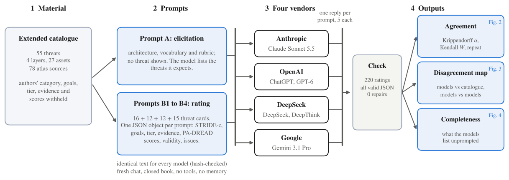

# LLM review panel

Four language models from four vendors review the 55-threat catalogue **blind**: they never see the authors' categories, goals,
tiers, evidence levels or scores. The panel is the first stage of the catalogue's validation: it tests whether the classification and the scores can be
reproduced by readers who did not write them, shows where readers disagree, and checks whether the catalogue misses threats that
models expect. The co-authors then evaluated the results and finalised the catalogue. The raters are language models, not domain experts.
Paper section: *Independent Review by a Multi-Vendor Panel of Language Models* (Section 4.11).



## Design in brief

| | |
|---|---|
| Models | Claude Sonnet 5.5 (Anthropic), ChatGPT GPT-6 with Think (OpenAI), DeepSeek with DeepThink, Gemini 3.1 Pro (Google); web applications |
| Prompt A | architecture, vocabulary and rubric, no threat shown; the model lists the threats it expects (completeness test) |
| Prompts B1 to B4 | the same context plus the threat cards of one layer (16, 12, 12, 15 threats); one JSON object per prompt with STRIDE-tau category, goals, tier, evidence level, PA-DREAD scores (Di for a strong and a weak geometric pass), a validity verdict and the issues seen |
| Conditions | identical prompt text for every model (SHA-256 checked), a fresh chat per prompt, history and memory off, closed-book instruction, replies saved unedited |
| Output | 4 models x 55 threats = 220 ratings, all valid JSON, none repaired; 143 threats listed in Prompt A |

Full protocol: [../docs/PANEL_PROTOCOL.md](../docs/PANEL_PROTOCOL.md). Model versions, dates, settings and deviations:
[../docs/PROVENANCE.md](../docs/PROVENANCE.md) and [run_log.csv](run_log.csv).

## Folder guide

| Path | What it is |
|---|---|
| `prompts/` | the exact text pasted into each chat; `manifest.json` lists the ids each prompt must return; `SHA256SUMS.txt` |
| `responses/` | main panel, strict JSON (fences, curly quotes, comments and trailing commas removed; no value changed). File name: `<model>__<prompt>__run<N>.json`. The ChatGPT files are from 29 Oct 2026, Gemini is run2 (Gemini 3.1 Pro) |
| `responses_raw/` | the same replies exactly as copied from the chat applications |
| `run_log.csv`, `COMMANDS_LOG.txt` | per run: model, mode, date, settings, prompt hash; command-by-command log and notes on deviations |
| `results/` | `panel_long.csv` (one row per model and threat), `panel_summary.csv` (one row per threat with consensus tags), `disagreements.csv`, `model_vs_catalogue.csv`, `agreement_alpha.csv`, `agreement_alpha_vs_W.csv/.xlsx`, `retest_chatgpt_B3_run1_vs_run2.csv`, `Panel_Review.xlsx` (all sheets), `validation_report.txt` |
| `retest/` | the second run of prompt B3 for ChatGPT (test-retest); not part of the main panel |
| `sensitivity/chatgpt_small_parts/` | ChatGPT's first session: the full B1 prompt was blocked, so B1 to B4 were sent as 14 small parts. Prompts, replies and the analysis with these replies in the ChatGPT seat. Superseded as the main panel, kept as a sensitivity check |
| `sensitivity/gemini_flash_lite/` | the first Gemini run (Gemini Flash-Lite, signed out): thin output, kept as a sensitivity check |
| `completeness/` | `elicitation_mapping_manual.csv`: the 143 threats listed in Prompt A mapped to the catalogue (C matches, P related, N no counterpart); `named.json`; `build_elicitation_mapping.py` |
| `figures/` | `fig1.py` to `fig4.py`, `fig_agree.py`, `common.py`; output in `figures/out/` (PDF and PNG) |
| `tools/` | `make_prompts_round1.py` and `prompt_blocks.py` (rebuild the prompts), `validate_merge.py` (validate, merge, per-threat tags), `agreement.py` (Krippendorff's alpha and Kendall's W), `retest.py` |

## Reproduce

From the repository root: `make panel` (analysis) and `make figures`. By hand, from `llm_panel/`:

```bash
python tools/validate_merge.py --out results_rebuilt
python tools/agreement.py --long results_rebuilt/panel_long.csv --out results_rebuilt
python tools/retest.py responses/chatgpt__B3__run1.json retest/responses/chatgpt__B3__run2.json --out results_rebuilt/retest_chatgpt_B3_run1_vs_run2.csv
python tools/make_prompts_round1.py ../data/catalogue/SATERA_Extended_Threat_Catalogue.xlsx prompts_rebuilt   # regenerates the prompts byte for byte
```

The sensitivity analysis with ChatGPT's small parts (`make sensitivity` from the repository root): copy `responses/` to a scratch folder,
remove `chatgpt__B1`..`chatgpt__B4`, add the files of `sensitivity/chatgpt_small_parts/responses/` except `chatgpt__B1a__run3` and `run4`
(those two were added after that analysis was made), and run the first two commands with `--responses <folder>`. The result equals
`sensitivity/chatgpt_small_parts/results/`.

## Repeat the review with another model

1. Paste `prompts/A_elicitation.txt` and each `prompts/B*.txt` into a fresh chat, one prompt per chat, history and memory off,
   no tools or attachments, whole file as one message, unedited. Record model version, mode and date in `run_log.csv`.
2. Save each reply as `responses/<yourmodel>__<prompt>__run1.json` (`<yourmodel>` letters and digits only) and keep the raw text in `responses_raw/`.
3. `python tools/validate_merge.py`: it checks every JSON, prints a coverage table and writes ready-to-paste repair prompts for files that fail.
4. `python tools/agreement.py`: agreement with the new model in the panel.

**Do not paste the catalogue workbook, or anything from it, into a chat before the blind runs are done**: it is the answer key.
